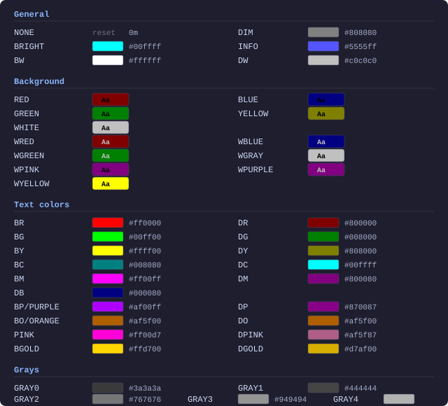

# GPPU — General Purpose Python Utilities

<h3><code>v3</code> — <em>All the things</em></h3>

> YAML-driven configuration with `!include` and `!secret`, colored structured logging, secret management (Azure Key Vault / env-vars), type coercion, deep dict access, YAML/JSON I/O, template population, time helpers, OS detection, async-to-sync, multi-backend caching, PostgreSQL and SQLAlchemy base classes, Textual TUI framework with superapp launchers, nested apps, config editors, web UI via `--serve`, and CLI fallback, Selenium Chrome automation, and home automation types.

[](https://github.com/akarelin/gppu/actions/workflows/gppu.yml) [](https://github.com/akarelin/gppu/releases?q=gppu)

Documentation from the code's docstrings, with this README and the documents beside it as guides: [kb.karel.in/gppu/v3](https://kb.karel.in/gppu/v3/), built by [docs/mkdocs.yaml](docs/mkdocs.yaml).


<table>
<tr>
<td width="140"><strong><a href="statusline/status_line.py">Statusline</a></strong></td>
<td><a href="https://github.com/akarelin/gppu/actions/workflows/statusline.yml"></a> <a href="https://github.com/akarelin/gppu/releases?q=statusline"></a></td>
<td>Claude Code 2-line status line (Linux, macOS, Windows)</td>
</tr>
<tr>
<td><strong><a href="w11/README.md">W11</a></strong></td>
<td><a href="https://github.com/akarelin/gppu/actions/workflows/w11.yml"></a> <a href="https://github.com/akarelin/gppu/releases?q=w11"></a></td>
<td>Windows 11 utilities &amp; diagnostics</td>
</tr>
<tr>
<td><strong><a href="rust/README.md">GPRU</a></strong></td>
<td><a href="https://github.com/akarelin/gppu/actions/workflows/rust-branch-build.yml"></a> </td>
<td>Rust port of <code>gppu</code> (in progress)</td>
</tr>
</table>

---
# Modules

| Module | Purpose |
|--------|---------|
| [`gppu.app`](gppu/app.py) | [`Env`](docs/environment.md), the configuration, with `!include` and typed path access (`glob`, `glob_int`, `glob_list`, `glob_dict`), and `_Base`, an object's logging and configuration.<br>[Apps](docs/app.md): `App`, `CliApp` for command-line utilities, `AsyncApp` on the YMRO steps, `APIApp` |
| `gppu` (core)<br> | **Logger**: colored `Info`/`Warn`/`Error`/`Debug`/`Dump`. <br>**Vault**: `Vault.get`/`create`/`update`/`list` with Azure Key Vault and `SECRET_*` env-var backends; `!secret` YAML tag.<br>Plus: type coercion, dict utilities, YAML/JSON I/O, time helpers, OS detection + `full_path` path resolution (env vars, `~`, WSL drive mapping), async helpers, template population |
| [`gppu.handlers`](docs/handlers.md) | Generated handler API and supported-format reference. |
| `gppu.ymro` | YMRO lifecycle: multi-inheritance-aware init→load→start steppers (`YInit`/`YLoad`/`YStart`/`mixin_Stepper`).<br>`Tracer` flight recorder: JSONL trace of object snapshots, triggers, callbacks, and periodic state (AppDaemon hooks via `Tracer.install`); `_tracer` before/after/instead method decorators |
| [`gppu.data`](DATA.md) | `Cache` unified caching (JSON/pickle/sqlite/diskcache/DB backends), <br>database base classes: `_PGBase` (psycopg2) and `_SQABase` (SQLAlchemy),<br>`_PersistentDC` persisted pseudo-dataclasses with `Persistence` multi-backend storage (json/pickle/sqlite/postgres) |
| [`gppu.iot`](IOT.md) | y2 types: `y2list`, `y2path`, `y2topic`, `y2slug`, `y2eid` (token-list strings for topics/slugs/entity ids).<br>MQTT plumbing for the any2mqtt services: `mqtt_connstring`, `MqttMixin` (reconnecting aiomqtt client with callback dispatch, MQTT5 expiry/user-properties), `Transformer` (config-driven scalar transform stage).<br>Control mixins: `_IORuntime` (thread-hosted asyncio loop, per-key gating), `_HTTPControl` (aiohttp), `_SerialControl` (telnetlib3), `_SerialHTTPControl`. Third-party deps via `mqtt`/`iot` extras |
| [`gppu.tui`](TUI.md) | `TUIApp`, `TUILauncher`, `ConfigEditorApp`, `ui_select`, `ui_select_rows`<br> Textual-based TUI framework with web mode (`--serve`), CLI fallback, app embedding. Requires `tui` extra |
| [`gppu.chrome`](CHROME.md) | `prepare_driver`, `switch_to_mobile`, `switch_to_desktop`<br>Selenium Chrome driver setup with profile management, crash recovery, mobile/desktop emulation |

## Handler listing

[`examples/handler_ls.py`](examples/handler_ls.py) prints complete metadata from `GppuFileSystem.info()` and `ls(recurse=True)`. [`examples/handler_browser.py`](examples/handler_browser.py) browses the same listings and displays all metadata. Both use `location: .` in [`examples/handlers.yaml`](examples/handlers.yaml); gppufs owns the colocated SQLite indexes. See [browsing and index behavior](docs/handler-browser.md).

```powershell
python examples/handler_ls.py
python -m examples.handler_browser
```

## Environment

`CliApp` loads configuration automatically. The explicit loader below is for code that needs configuration without constructing an app.

```python
from gppu import Env
from pathlib import Path

# Initialize: resolves config file, loads YAML (with !include and !secret support)
Env.from_env(name='myapp', app_path=Path(__file__).parent)

# Typed access via "/" path
db_host = Env.glob('database/host', default='localhost')
port    = Env.glob_int('database/port', default=5432)
tags    = Env.glob_list('metadata/tags')
options = Env.glob_dict('database/options')
```

Config file resolution: looks for `<name>.yaml` then `config.yaml` in the app path. Relative `app_path` values are resolved by walking up from the calling script's directory until a matching subpath is found.

[Configuration from MQTT](docs/mqtt-config.md): startup loading, optional live updates, and `AppService.on_change()` notifications for the affected configuration paths.

[Env](docs/environment.md): the global configuration and what any app looks up — its name, host, platform, the trace rules; every object reads it from its `_my`.

[The REST surface](docs/rest.md): `mixin_Rest`, for an async app — every registered object answers for its own members, walked from the classes born under `Env.app_path`; manifest, read, call.

YAML `!include` support, as the value of a key or on its own line, where the included file's keys merge into the document:
```yaml
!include hosts.yaml

app:
  name: MyApp
  database: !include database.yaml
```

## Logger

```python
from gppu import Info, Warn, Error, Debug, Dump

Info('WBLUE', 'server', 'NONE', 'started on port', 'BG', '8080')
Warn('WYELLOW', 'config', 'NONE', 'key missing, using default')
Error('WRED', 'database', 'NONE', 'connection refused')
Debug('GRAY4', 'trace', 'NONE', 'processing item')

Dump('debug_state.yml', data)
```

## Vault

Static facade over a pluggable provider chain. Provider auto-detected on first use: `AZURE_KEYVAULT_NAME` → Azure Key Vault, else `SECRET_*` env-vars. `SECRET_<NAME>` env vars always win over the persistent provider.

```python
from gppu import Vault

token   = Vault.get('anthropic-api-key')           # checks SECRET_ANTHROPIC_API_KEY first
Vault.create('slack-bot-token', 'xoxb-...')         # raises if it already exists
Vault.create('slack-bot-token', 'xoxb-...', designation='T01')  # collision → slack-bot-token-t01
Vault.update('openai-api-key', 'sk-...', create=True)
names = Vault.list()                                # env-var union with provider listing
```

In YAML: `password: !secret db-pass` resolves at load time via `Vault.get`. Requires the `vault` (or `vault-azure`) extra.

## How Apps Work

Command-line utilities subclass `CliApp`, define `main`, and call `MyApp.cli()`. Construction loads the shared configuration and logging; the command line overrides keys of the configuration, and gppu prints what `main` returns as JSON. Do not build that setup in each utility. Use `App` for an object called directly and `AsyncApp` for asyncio work; see [Apps](docs/app.md).

### 1. Use the project's shared configuration

When the script folder needs a configuration entry point, `config.yaml` includes the existing shared configuration. Settings remain there; do not copy them into a utility-specific file.

```yaml
!include ../_config/_config.yaml
```

### 2. Define the command's work

This example takes `logs`, `level` and `days` from the configuration. The command line overrides those keys.

```python
from gppu import CliApp

class MyApp(CliApp):
    def main(self) -> dict:
        """Read the configured logs."""
        logs, level, days = self.my('logs'), self.my('level'), self.my('days')
        self.Info('Reading logs', level, days)
        return {'logs': logs, 'level': level, 'days': days}

if __name__ == '__main__':
    MyApp.cli()
```

No arguments runs `main` with configuration values. `--days 7` overrides `days`; every value is read as YAML, so `--dry-run true` is a boolean. Returned data goes to stdout as JSON and logs go to stderr. See [`gppu.app.CliApp`](gppu/app.py).

### 3. For TUI apps — subclass `TUIApp` and use `Env` the same way:

```python
from gppu import Env
from gppu.tui import TUIApp

class MyApp(TUIApp):
    TITLE = 'My App'
    def compose(self):
        ...

Env.from_env(name='myapp', app_path=Path(__file__).parent)
MyApp.main()  # TUI if terminal available, CLI fallback otherwise
```

### 4. For superapp launchers — a launcher config lists sub-apps, each with its own YAML:

```yaml
# launcher.yaml
apps:
  events: events.yaml
  onedrive: onedrive.yaml
```

Each sub-app YAML has a `manifest:` section (name, icon, script, modes) plus app-specific config below it. The launcher loads all manifests and presents a menu.

```python
from gppu import Env
from gppu.tui import TUILauncher, launcher_main, load_app_registry

APP_DIR = Path(__file__).parent

class MyLauncher(TUILauncher):
    TITLE = 'My Tools'

Env.from_env(name='launcher', app_path=APP_DIR)
apps = load_app_registry(APP_DIR)
launcher_main(apps, MyLauncher, APP_DIR, 'My Tools')
```

See [w11/app.py](w11/app.py) for a real example.

# Other Products

[Statusline](statusline/status_line.py) — Claude Code status line tool
`curl -fsSL https://raw.githubusercontent.com/akarelin/gppu/master/statusline/install-statusline.sh | sh`

[W11](w11/README.md) — Windows 11 utilities


# Appendix
## Installation

```bash
# From GitHub
pip install "gppu @ git+ssh://git@github.com/akarelin/gppu.git@gppu/latest"

# With optional extras
pip install "gppu[pg] @ git+ssh://git@github.com/akarelin/gppu.git@gppu/latest"
pip install "gppu[all] @ git+ssh://git@github.com/akarelin/gppu.git@gppu/latest"

# Local development
pip install -e ".[all,test]"
```

**Optional extras**: `pg` (psycopg2), `sql` (SQLAlchemy), `cache` (diskcache), `mqtt` (aiomqtt), `iot` (aiomqtt + aiohttp + telnetlib3), `chrome` (Selenium), `tui` (Textual), `serve` (textual-serve), `statusline` (Jinja2), `vault-azure`, `vault` (= `vault-azure`), `all`, `test` (pytest), `test-tui` (pytest + pytest-asyncio + textual).

Requires Python >= 3.11. Core dependency: PyYAML.

## TColor Reference

Hex values computed from ANSI codes in `gppu/gppu.py` (xterm-256color palette).




## License

Extracted from RAN project for reuse across Alex Karelin's automation and data processing tools.
