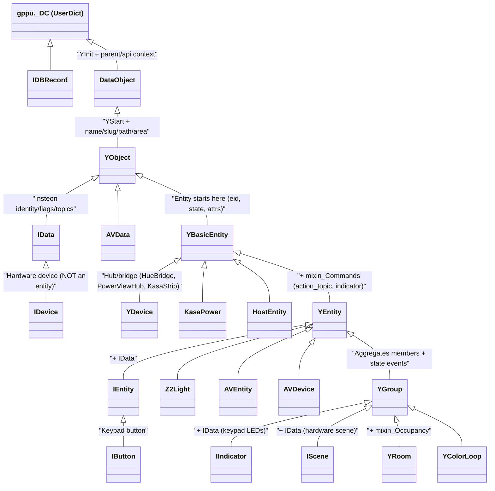
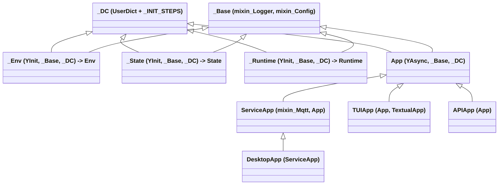

# Class Hierarchy: Current Y2 Core & New `gppu` Mapping

> Ground-truth AST inventory from Classic Y2 (`IoT/archive/ad.deprecated/_adev/Y2`), Current Live `y2/y2`, and `gppu/gppu`, paired with the proposed target mapping.

---

## 1. Current Y2 Object Core (Unchanged > 1 Year)

This hierarchy is identical between AppDaemon-era Y2 and live `y2/y2`. **None of this belongs in `gppu` — it stays in `y2`.**

### Key invariants of the Y2 core
- **`_DC`** → dict-backed pseudo-dataclass (`IDBRecord`).
- **`DataObject(YInit, _DC)`** → separates context (`parent`, `api`) from `self.data`.
- **`YObject(YStart, DataObject)`** → adds `name`/`slug`/`dashed`/`path`/`area`/`subarea` + lifecycle (`init`/`start`/`stop`). Not an entity (`IDevice` stops here).
- **`YBasicEntity(mixin_Attributes, YObject)`** → where **Entity** begins: single `y2eid` (`eid`/`ns`/`domain`/`entity_id`/`seid`), state, attributes, MQTT state listener, refresh.
- **`YEntity(mixin_Commands, YBasicEntity)`** → adds commands, `action_topic`, `indicator`.
- **`YGroup(YEntity)`** → aggregates `members` (other entities, resolved by `eid`) and reacts to member state changes (`YRoom`, `IIndicator`, `IScene`, `YColorLoop`, `PowerViewCoverGroup`, `HueScene`).

---

## 2. Current Y2 App Core (AppDaemon vs. Live `y2/y2`)

| Role | Classic Y2 (AppDaemon) | Live `y2/y2` |
|---|---|---|
| Process entry / orchestrator | AppDaemon process | `Y2(AsyncApp)` in `__main__.py` |
| Single Y2 app | `Y2App(AppObject)` | `y2entity.App(mixin_Timers, AsyncApp)` |
| Object-list + polling manager | `StateManager(Y2App)` (`GSM`, `AVSM`, `HueSM`, `PowerViewSM`, `KasaSM`, `mPowerSM`) | Merged into `y2entity.App` |
| Insteon manager | `Insteon(ADBase)` + `ISM(Y2App)` | `Insteon(App)` |
| Action / ToD / UI / API / Supervisor | `AM`, `TOD`, `UI`, `API` (`Y2App`) | `AM`, `TOD`, `UI`, `API`, `Supervisor` (`y2entity.App`) |
| Shared config | `y2env.Environment` | `gppu.Env` (`glob*`) |
| Shared state + MQTT | `y2env.State` + per-app `Y2Api(mixin_Mqtt)` | `y2entity._State(App, mixin_Mqtt)` |
| App registry | AppDaemon | `y2entity._Runtime` (marked `# !!!` by Alex) |

---

## 3. Target `gppu` Hierarchy — What Each Class Is For

**No separate `AsyncApp`.** Every `App` runs on `Runtime` (sync or async hooks both work — a simple script writes `def __start(self)` and never cares about `async`, while `Preservator`, `ConfigureAll`, `FleetTUI`, and `Y2` use `async` and timers directly on `Runtime`).

### The three process singletons — how they serve BOTH `Y2` and `Fleet`

| Singleton | Role | In `Y2` | In `Fleet` (RAN) |
|---|---|---|---|
| **`Env`** (`_Env`) | Read-only config + machine facts (`os`, `host`, `user`, `home`) + `glob*()`. Loaded once at import. | `IoT/_Creekview/_creekview.yaml` (`y2`, `insteon`, `groups`, `mqtt`) | `RAN/_config/config.yaml` (`hosts`, `runbooks`, `locations`, `preservator`) |
| **`State`** (`_State`) | Persistent mutable runtime key/value store (`State[key]` via `gppu.data.Cache`) + deduplicated object registry (`register`/`unregister`/`get_object`). | Entity states (`State[seid]`), sensor readings, registered entity lookup | Host reachability, `preservator` cutoffs, `rewrite-commits` per-repo last-update dates |
| **`Runtime`** (`_Runtime`) | The process's **one asyncio event loop**, task spawning/scheduling (`spawn`, `schedule`), **timers** (`run_later`, `run_every`, `cancel_timer`, `timers`, `h_timeouts`), and `run_app` / `call`. | Runs `Y2` + all StateManagers on one loop; drives polling, occupancy vacancy, and debounce timers | Runs `Preservator` / `ConfigureAll` / `FleetTUI` host work concurrently on one loop; drives timeouts/probes |

### App types — what each is for and what becomes what

| New `gppu` Class | Purpose | Current classes / scripts that become this |
|---|---|---|
| **`_DC`** (+ `_Base` + `YInit`) | Passive dict-backed data objects (no `load`/`start`/`stop`, no loop, no CLI). Fixes class-default inheritance. | `Fleet`: `Host`, `Fleet`. `Y2`: `IDBRecord`, `DataObject` (keeps its existing `parent`/`api` meaning in `y2`), `YObject`, `IData`, `IDevice`, `YBasicEntity`, `YEntity`, `YGroup`, `YRoom`. |
| **`App`** (`YAsync, _Base, _DC`) | Base runnable app on `Runtime` (sync **or** async hooks, `parent`/`children` cascade, config from `glob_dict(name)` + `config=`, CLI overrides on `run()` only). | `Fleet`: `Preservator`, `ConfigureAll`, `Configs`, `SynologyMount`, `RewriteCommits` (CLI). `Y2`: base for `Y2App` / `StateManager` (`GSM`, `AVSM`, `HueSM`, `PowerViewSM`, `KasaSM`, `TuyaSM`, `SensiboSM`, `ZwjsSM`, `HostSM`, `FlumeSM`, `Insteon`, `AM`, `TOD`, `UI`, `Supervisor`). `CRAP`: ETL scripts. |
| **`ServiceApp`** (`mixin_Mqtt, App`) | Always-running background daemon with MQTT transport and optional `config_mqtt/topics` (replaces `AppService`). | `Y2` (`__main__.py`), `mqtt2pg`, `brul2mqtt`, `lastfile2mqtt`, `hue2mqtt`, `xmqtt2mqtt`. |
| **`DesktopApp`** (`ServiceApp`) | Windows/desktop service with tray icon, loopback CLI control, and `--install`/`--uninstall`. | `IoT/PCC`: `PCControl` (`pc-control.py`). |
| **`TUIApp`** (`gppu.tui`) | Interactive Textual terminal UI attaching `Runtime` to Textual's loop. Config-generated menus (`TUILauncher`) need zero TUI code. | `Fleet`: `FleetTUI`, `RewriteCommitsTUI`, `TUILauncher`. |
| **`APIApp`** (`gppu.api`) | HTTP/REST API service running on `Runtime`. | `Y2`: `API` / `UI` HTTP surface; Linked Data / Lake APIs. |

---

## 4. What Stays in `y2` (Not in `gppu`)

- **`DataObject(YInit, _DC)`** — keeps its existing `y2` meaning (`parent`, `api`).
- **`YObject` → `YBasicEntity` → `YEntity` → `YGroup` → `YRoom`** and all device/domain subclasses (`Insteon`/`IData`/`IDevice`/`IEntity`/`IButton`/`IIndicator`/`IScene`, `AV*`, `Hue*`, `PowerView*`, `Kasa*`, `Tuya*`, `Sensibo*`, `Zwjs*`, `Host*`).
- **`Y2App(mixin_Timers, AsyncApp)`** & **`StateManager(Y2App)`** — Y2's managed app base, config-list object construction, round-robin polling, entity state events, and MQTT state publishing.
- **`y2eid` / `y2slug`** — Y2 entity identity.
