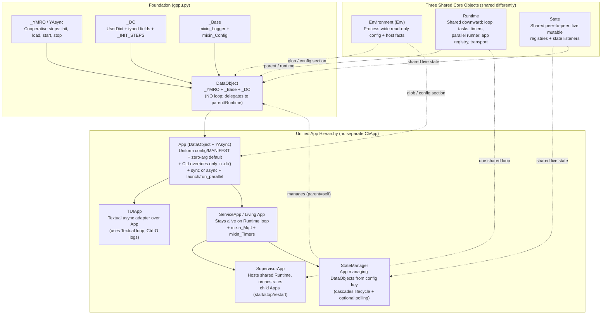

# gppu Architecture — Iteration 2 (Integrating Comments #1–#10)

Scope: **RAN `tui.ps1`** (mount SMB, mount S2, `tray-control`, `rewrite-commits`, server/workstation/Pi update/preserve/maintain) and **IoT / `y2`** (including PC Control as a standard consumer; Web UI / `UI_API` parked until 1–4 are solid).
Reference codebases: live `gppu` ([gppu.py](file:///D:/Dev/gppu/gppu/gppu.py), [app.py](file:///D:/Dev/gppu/gppu/app.py), [iot.py](file:///D:/Dev/gppu/gppu/iot.py)), [deleted_by_fable.py](file:///D:/Dev/gppu/gppu/deleted_by_fable.py), AppDaemon-era `gppu` at [gppu-v3.4.6](file:///D:/Work/11/24/gppu-appdaemon/gppu-v3.4.6/gppu/), and AppDaemon-era Y2 at [ad.deprecated/_adev/Y2](file:///D:/Dev/IoT/archive/ad.deprecated/_adev/Y2/).

---

## 1. Core Architectural Principle: Environment, Runtime, State

The three most important objects in `gppu` are **Environment**, **Runtime**, and **State** — all three are shared, each in a different way:

| Core Object | Owns | How It Is Shared | Must NOT Own |
|---|---|---|---|
| **Environment** (`Env`) | Static configuration (YAML + includes + Jinja, ~~`topology`~~/~~`tunables`~~, shared lists like mountable SMB shares) and host facts (`os`, `host`, `user`, `home`, `path`). Environment does not provide any functionality except for helpers. | **Process-wide read-only singleton** loaded once; every script, app, and `DataObject` reads it via `glob*` or its own config section (mutated only on explicit reload or remote MQTT config feed). | Event loops, live entity state, MQTT clients, app registries. |
|                         |                                                                                                                                                                              |                                                                                                                                                                                                    |                                                               |
| **Runtime** | Execution engine: asyncio event loop, background tasks (`_spawn`, `schedule`), timers (`run_every`, `run_later`), parallel process runner (`launch`, `run_parallel`), app lifecycle registry (start/stop/restart), and shared IO/MQTT transport when hosted by a supervisor. | **Shared downward by ownership (`parent` / `runtime` / `api`)** — one process or `SupervisorApp` owns one `Runtime`, and every child `App` or `DataObject` delegates to it instead of creating its own loop. Standalone apps use the process default runtime transparently. | Static YAML topology, domain entity state/groups. |
| **State** | Live mutable domain registries and values (e.g., Y2 `entities`/`eids`, `groups`, `sensors`, `actions`, `indicators`) plus state-change observation (`get_state`, `set_state`, `listen_state`). | **Shared peer-to-peer across cooperating apps and `DataObject`s** in a domain (e.g., `room.ao@yala`, `Insteon`, `HueSM`, `TOD`, `GSM`, `AM` all read/write the same `State`, and cross-process consumers see published state over MQTT). | Its own event loop, `AsyncApp` overrides, or MQTT client wrapper overrides (the exact `# !!` violations in [y2entity.py](file:///D:/Dev/y2/y2/y2entity.py#L1796-L1926)). |

---

## 2. Clean 5+1 Category Model (Replacing the 9-Scenario Fragmentation)

Integrating comments #1–#10 collapses all in-scope programs into **five app categories plus `DataObject`** (not an app):

| Category | Role & Entry Points | Examples in Scope | Proposed Base / Composition |
|---|---|---|---|
| **0. `DataObject`** *(not an App)* | Config-driven `_DC` + lifecycle object; **never owns an event loop**. Reaches MQTT, timers, and loop via `parent` / `Runtime`, and shares `Environment` + `State`. | `room.ao@yala` (`YGroup`), `YObject`, `YEntity`, `YDevice`, `HueLight`, `KasaStrip`, `PowerViewHub`, `AVMatrix`, `IDBRecord` | `DataObject(_YMRO, _Base, _DC)` + optional device-control mixin (`HTTPControl`, `JSONHTTPControl`, `SerializedControl`) |
| **1. One-off scripts (ETLs / cron)** | Zero-arg default action from config/manifest; CLI flags are **overrides only**; no separate `CliApp`. Sync or async transparently; can run tasks in parallel. | [preservator.py](file:///D:/Dev/RAN/Hosts/preservator/preservator.py), [configure-all.py](file:///D:/Dev/RAN/Hosts/configure-all/configure-all.py), [configs.py](file:///D:/Dev/RAN/Hosts/configure-all/configs.py), [i-tod-update.py](file:///D:/Dev/IoT/i-tod-update.py), [wled-clock.py](file:///D:/Dev/IoT/wled-clock.py), [homebridge/compile.py](file:///D:/Dev/IoT/homebridge/compile.py), [list-sessions.py](file:///D:/Dev/RAN/Hosts/tui/list-sessions.py) | **`App`** (one unified base; `App.cli()` applies CLI overrides and runs default action; importing & calling in Python never touches `sys.argv`) |
| **2. Interactive scripts (CLI / TUI / Python import)** | User-run tools where the **exact same code** runs via CLI (default action + `--overrides`), TUI menu, or Python import + function call. Shared `Environment` removes hardcodes (e.g., mountable SMB shares in [shares.yaml](file:///D:/Dev/RAN/_config/file_indexer/shares.yaml)). Textual TUIs are always async. | **Scripts:** [synology-mount.py](file:///D:/Dev/RAN/Hosts/synology-mount.py), [mapper.cmd](file:///D:/Dev/RAN/Hosts/mapper.cmd) (→ config-driven SMB mount), [tray-control.ps1](file:///D:/Dev/RAN/Hosts/tray-control.ps1) **Textual TUIs:** [tui.py](file:///D:/Dev/RAN/Hosts/tui/tui.py), [fleet-tui.py](file:///D:/Dev/RAN/Hosts/configure-all/fleet-tui.py), [rewrite_commits.py](file:///D:/Dev/RAN/Hosts/rewrite-commits/rewrite_commits.py), [tui/configs.py](file:///D:/Dev/RAN/Hosts/tui/configs.py) | **`App`** (uniform manifest/config + CLI/TUI/import dispatch) + **`TUIApp`** (Textual async adapter over `App` — attaches to Textual's loop instead of fighting `AsyncApp.run()`) |
| **3. Living-object apps (always-on)** | Always-running standalone daemons on `Runtime`'s asyncio loop (`init` → `load` → `start` → stays alive until `stop`). Uniform MQTT + config — PC Control adapts to this without dictating special base classes. | [mqtt2pg.py](file:///D:/Dev/y2/mqtt2pg/mqtt2pg.py), [y2trace.py](file:///D:/Dev/y2/trace/y2trace.py), [news.py](file:///D:/Dev/y2/news/news.py), [lastfile2mqtt.py](file:///D:/Dev/IoT/any2mqtt/lastfile2mqtt.py), [xmqtt2mqtt.py](file:///D:/Dev/IoT/Projects/neo-mqtt/mesh/engine/xmqtt2mqtt.py), [pc-control.py](file:///D:/Dev/IoT/PCC/src/pc-control.py) | **`ServiceApp`** *(or `App` with `stay_alive`)* + `mixin_Mqtt` + `mixin_Timers` (plus optional remote-config listener for MQTT-fed hosts like PC Control) |
| **4. Services managing `App`s or `DataObject`s** | Two clean orchestrator patterns: **(a) `SupervisorApp`** hosts a shared `Runtime` and orchestrates child `App`s (load/start/stop/restart on one shared loop & transport); **(b) `StateManager`** manages a config-driven set of `DataObject`s (`parent=self`, cascading lifecycle, optional polling). | **Supervisor:** [y2/__main__.py](file:///D:/Dev/y2/y2/__main__.py) (`Y2` hosting `Insteon`, `ISM`/SMs, `TOD`, `GSM`, `AM`, `Supervisor`), [brul2mqtt.py](file:///D:/Dev/IoT/any2mqtt/brul2mqtt.py) (hosting multiple `Transformer`s) **Managers:** `Insteon`, `GSM`, `HueSM`, `AVSM`, `KasaSM`, `PowerViewSM`, `TuyaSM`, `SensiboSM`, `ZwjsSM`, `HostSM`, `EcobeeSM`, `NestSM`, `FlumeSM` | **`SupervisorApp`** (owns shared `Runtime`, orchestrates child `App`s) and **`StateManager`** (an `App` managing `DataObject`s from a config key, like AppDaemon-era [Y2_services.py](file:///D:/Dev/IoT/archive/ad.deprecated/_adev/Y2/Y2_services.py#L158-L255)) |
| **5. UI / UI_API** *(parked)* | Web UIs and REST/API servers. | [y2/ui/ui.py](file:///D:/Dev/y2/ui/ui.py) (`iot.karel.in` / `creekview.karel.in`), [y2/y2/ui.py](file:///D:/Dev/y2/y2/ui.py) (`API`, `UI`) | *Deferred until Categories 0–4 are aligned* (preserve `Env.path` so `y2/ui/creekview.py` stays intact). |

---

## 3. Proposed Minimal Base-Class Structure (Draft for Review)

### How Each Entry Point Works on the Exact Same `App` Code

Taking [synology-mount.py](file:///D:/Dev/RAN/Hosts/synology-mount.py) or [preservator.py](file:///D:/Dev/RAN/Hosts/preservator/preservator.py) as the canonical simple-app example:

- **Import & call in Python:** `app = SynologyMount(server='s2'); app.mount('Archive*')` — construction loads `Env` section + optional `config=` + passed kwargs, and **never reads `sys.argv`** and **never has import-time side effects**.
- **Zero-arg CLI:** `python preservator.py` or `python list-sessions.py` — `App.cli()` parses `--key value` / `--flag` as overrides over config/manifest, then runs the configured **default action** (`main()` or configured `default_action`).
- **CLI with overrides:** `python list-sessions.py --action clean` or `python synology-mount.py --action mount --pattern "Archive*"` — same `App.cli()`, zero `argparse` boilerplate per script.
- **TUI launcher (`tui.ps1`):** reads the app's `MANIFEST` (name, description, icon, platform, modes/actions) and invokes the same app/modes without duplicating definitions between `MANIFEST`, `ACTIONS`, and `argparse`.
- **Parallel tasks in CLI or TUI:** `App` exposes `launch` and `run_parallel` (via `Runtime`) so both `fleet-tui.py` and headless CLI utilities (`preservator`, `configure-all`, `configs`) run concurrent host tasks identically.

---

## 4. Open Questions Before Locking the Base-Class Design

Please answer these **6 targeted questions** so we can lock the exact class signatures and start aligning `gppu`, `tui.ps1`, and `IoT`/`y2`:

1. **`Environment`, `Runtime`, `State` ownership & sharing boundaries:**
   - Does **Environment = process-wide static config**, **Runtime = execution engine shared downward from host/supervisor (`loop`, tasks, timers, parallel runner, app registry, optional shared MQTT)**, and **State = peer-shared mutable domain registries (`entities`, `groups`, `sensors`, `actions`, listeners — no loop, no MQTT overrides)** match how you want the three separated?
   - Specifically for **`State`**: should `gppu` provide a minimal generic `State` base/singleton (key/value + registries + listeners, like [deleted_by_fable.py](file:///D:/Dev/gppu/gppu/deleted_by_fable.py#L4461-L4504)) that `y2` extends, or does `State` stay domain-defined per app family while `gppu` provides the base class/mixin?

2. **Declarative CLI/TUI/Python contract (`MANIFEST` vs Python annotations/methods):**
   - To eliminate ad-hoc `argparse` across every utility while keeping `tui.ps1` fast (able to build menus without importing heavy scripts, and still supporting `.ps1`/`.cmd` like `mapper.cmd` and `tray-control.ps1`):
   - **Option A (Recommended):** Keep lightweight **`MANIFEST` YAML** (name, description, icon, platform, default action, named modes/presets) + **`_DC` typed fields / `App` methods** for the actual parameters and execution — `App.cli()` maps `--field value` / `--flag` / `--action` onto `_DC` data and invokes the action (default action when no args are given).
   - **Option B:** Derive CLI options and TUI prompts purely from Python method signatures (like deleted `CliApp` in [deleted_by_fable.py](file:///D:/Dev/gppu/gppu/deleted_by_fable.py#L3934-L3966)) and use `MANIFEST` only for launcher listing.
   - Also: when a script has **both** a launcher `MANIFEST` and an `Env` section (like `preservator.py`) and is passed an explicit `config=path`, confirm precedence: **`Env` section < `MANIFEST` (app config, not `manifest:` launcher block) < explicit `config=` < passed `**kw` < CLI `argv` (only inside `.cli()`)**?

3. **One `App` class vs `App` + `ServiceApp`:**
   - With sync/async unified in `App` (using `YAsync`), do you prefer:
     - **Option A:** One `App` base (runs `init` → `load` → `start` → default action and exits, unless marked long-running / given background tasks via `_spawn`), plus `SupervisorApp` and `StateManager` subclasses; OR
     - **Option B:** Explicit **`App`** (one-off & interactive — runs action and exits) and **`ServiceApp`** (always-on living object — stays alive on `Runtime` loop until `stop()`), with `SupervisorApp` and `StateManager` under `ServiceApp`?

4. **`SupervisorApp` and `StateManager` placement (`gppu` vs `y2`):**
   - Should **`SupervisorApp`** (loads/starts/stops/restarts child `App`s on one shared `Runtime`) AND **`StateManager`** (manages a config-driven collection of `DataObject`s with `parent=self`, cascading lifecycle, and optional polling — modeled on AppDaemon-era [StateManager](file:///D:/Dev/IoT/archive/ad.deprecated/_adev/Y2/Y2_services.py#L158-L255)) **both live in `gppu`** so `y2` drops `y2entity.App` + `_Runtime` and only adds Y2 entity/domain logic?
   - Or should only `SupervisorApp` live in `gppu` and `StateManager` live in `y2`?

5. **MQTT connection ownership & config key (`mqtt` vs `connection`):**
   - In Y2 (`SupervisorApp`), should the **supervisor / `Runtime`** hold the one shared MQTT connection (so `State` is pure state and child apps/entities call `self.runtime.mqtt_publish` / `mqtt_listen`), while standalone living apps (`brul2mqtt`, `lastfile2mqtt`, `mqtt2pg`, `y2trace`, `news`, `pc-control`) mix in `mixin_Mqtt` with their own connection?
   - Confirm unifying on **`mqtt:`** (replacing `connection:` in `y2trace`/`news`/`pc-control`) and adding an optional raw-bytes/wire hook on `mixin_Mqtt` so `mqtt2pg` and `y2trace` drop their hand-rolled `aiomqtt` loops?

6. **`stop()` contract and Y2 sync device calls (`SerializedControl` + `mixin_Timers`):**
   - **Lifecycle `stop()`:** Every live `stop()` caller today is synchronous (`launcher.py`, `AppService`, `api.py`, `y2entity.py`), whereas `YAsync.stop` in [gppu.py](file:///D:/Dev/gppu/gppu/gppu.py#L1173) is `async def`. Should `stop()` stay **synchronous** (scheduling cancellation onto `Runtime`'s loop via `call_soon_threadsafe`) or move to **`async def stop()`** and update callers?
   - **Timers & Controls:** In [gppu-v3.4.6/app.py](file:///D:/Work/11/24/gppu-appdaemon/gppu-v3.4.6/gppu/app.py#L284-L326), `mixin_Timers` was 42 lines of pure asyncio; today it allocates a `ThreadPoolExecutor` only because Y2 entities call blocking sync `SerializedControl._control_call()` inside `refresh()`. Do you want to **keep a clean thread-bridge (`EventLoopBridge` + `SerializedControl`) for sync Y2 drivers during this refactor**, or **convert Y2 device refreshes/commands to native `async`** now so `mixin_Timers` returns to pure asyncio?

---

## 5. Reference: Prepared AppDaemon Codebase & Key Junk Replacements

Prepared clean snapshots at `D:\Work\11\24\gppu-appdaemon\` (all verified syntax-clean on Python 3.14):

- [gppu-v3.4.6](file:///D:/Work/11/24/gppu-appdaemon/gppu-v3.4.6/gppu/) — final AppDaemon-era `gppu` (`Env.from_dict` with `topology`/`tunables`, `_DC._INIT_STEPS`, clean separate sync `_YMRO` & async `aYMRO`, 42-line pure-asyncio `mixin_Timers`, `mixin_Mqtt`, `_HTTPControl`, `_PersistentDC`/`Persistence`).
- [gppu-ad-v3.2](file:///D:/Work/11/24/gppu-appdaemon/gppu-ad-v3.2/gppu/) — last snapshot with `ad.py` and standalone `ymro.py`.
- [gppu-v3.5.4](file:///D:/Work/11/24/gppu-appdaemon/gppu-v3.5.4/gppu/) — minimal 202-line post-AppDaemon `app.py` + `iot.py` (`MqttApp`, `EventLoopBridge`, `SerializedControl`, `HTTPControl`, `JSONHTTPControl`).
- [ad.deprecated/_adev/Y2](file:///D:/Dev/IoT/archive/ad.deprecated/_adev/Y2/) — AppDaemon-era Y2 (`DataObject`, `Y2App`, `StateManager`, `Environment`, `State`).

Summary of junk replacements / breaks to clean up once Questions 1–6 are answered (from live code + [deleted_by_fable.py](file:///D:/Dev/gppu/gppu/deleted_by_fable.py)):

- **Duplicate async lifecycle:** `AsyncApp` in [app.py](file:///D:/Dev/gppu/gppu/app.py#L54-L99) duplicates `YAsync` in [gppu.py](file:///D:/Dev/gppu/gppu/gppu.py#L1133-L1200) and crashes on dropped `self.stopped`; collapsing `YInit = YLoad = YStart = _YMRO` breaks `YObject(YStart, DataObject)` MRO in [y2entity.py](file:///D:/Dev/y2/y2/y2entity.py#L589).
- **Config / `MANIFEST` / `Env`:** `App.__init` checks `MANIFEST` before `config=` (breaking `Preservator(config=...)`) and unconditionally reads `sys.argv[1:]` (breaking Python import usage); `Env.path` was dropped (breaking [creekview.py](file:///D:/Dev/y2/ui/creekview.py#L35-L41)); `Env.home` changed on W11 to `D:/Dev`; `_DC.__init__` `@final` clashes with all 5 `TUIApp` subclasses and `_State`.
- **Fragmented MQTT & deleted bridge:** `MqttApp` and `EventLoopBridge` (`submit`/`call`) were deleted ([deleted_by_fable.py](file:///D:/Dev/gppu/gppu/deleted_by_fable.py#L1067-L1105), [L1861](file:///D:/Dev/gppu/gppu/deleted_by_fable.py#L1861)); 4 IoT services hand-roll duplicate `aiomqtt` reconnect loops; `_State` in [y2entity.py](file:///D:/Dev/y2/y2/y2entity.py#L1820-L1846) overrides `mixin_Mqtt`.
- **Bloated / unreviewed code:** `mixin_Rest` in [app.py](file:///D:/Dev/gppu/gppu/app.py#L259-L349) (marked `# !!`); `y2entity.App`, `_Runtime`, `_State` in [y2entity.py](file:///D:/Dev/y2/y2/y2entity.py) (marked `# !! Eradicate`); 109-line `JinjaEnvironment` (`# region Jinja (AI, not human reviewed)`).
- **Deleted utilities worth confirming keep vs drop:** `Logger.enable_file_logging`/`file_log`/`_PlainFormatter`/`dpcp`, `format_duration`/`format_since`, `dict_to_json`/`dict_from_json`, `_PersistentDC`/`Persistence`/`Cache.skip`, `y2eid`/`y2slug`, `my_list`/`my_dict`.
