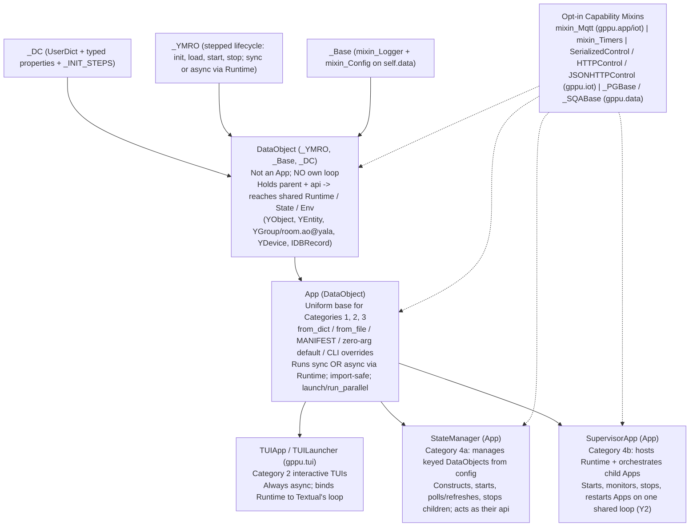

# gppu Architecture Review — Iteration 2: Shared Core, App Categories, and Base-Class Design

Scope: **RAN `tui.ps1`** ([tui.ps1](file:///D:/Dev/RAN/Hosts/tui.ps1)) and **IoT / `y2`** (Web UI and its API parked until the core is on a solid path).
Prepared clean reference codebase: [gppu-appdaemon](file:///D:/Work/11/24/gppu-appdaemon/) (`gppu-v3.4.6`, `gppu-ad-v3.2`, `gppu-v3.5.4`), AppDaemon Y2 reference at [ad.deprecated/_adev/Y2](file:///D:/Dev/IoT/archive/ad.deprecated/_adev/Y2/), and deleted code archive at [deleted_by_fable.py](file:///D:/Dev/gppu/gppu/deleted_by_fable.py).

## 1. Integrated Requirements (From Your 10 Points)

1. **Three central shared objects:** `Environment`, `Runtime`, and `State` are the most important objects in `gppu`; all three are shared, each differently.
2. **Five app categories + `DataObject`:** (1) One-off scripts/ETLs (cron), (2) interactive user scripts (CLI/TUI), (3) always-on living-object apps (`mqtt2pg`), (4) services managing child apps or `DataObject`s (`SupervisorApp` / `StateManager`), (5) Web UI / UI API (parked for now) — plus **`DataObject`** (`_DC` + lifecycle, NOT an App, never owns a loop).
3. **One code path across CLI, TUI, and Python import:** The simplest utilities (e.g. [synology-mount.py](file:///D:/Dev/RAN/Hosts/synology-mount.py), SMB mount, sync/apply/clean scripts, [preservator.py](file:///D:/Dev/RAN/Hosts/preservator/preservator.py)) run identically via CLI, TUI, or importing the file and calling a function — pulling shared paths and lists (such as mountable SMB shares from [locations.yaml](file:///D:/Dev/RAN/_config/topology/locations.yaml) / [config.yaml](file:///D:/Dev/RAN/_config/config.yaml)) from `Environment` with zero hardcodes.
4. **No `CliApp` and no per-script `argparse`:** Every app runs its configured default action with zero arguments; CLI flags only override values in config/manifest, replacing ad-hoc CLI parsing with one declarative layer.
5. **Sync vs async does not split simple apps:** Simple apps should not care whether they are sync or async; TUI apps are always async, and some simple CLI utilities need parallel task execution.
6. **Supervisor and StateManager orchestration:** A `SupervisorApp` orchestrates smaller child apps inside one shared `Runtime` (e.g. `Y2` running `Insteon`, `ISM`/state managers, `TOD`, `GSM`, `AM`); a `StateManager` manages `DataObject` instances (`room.ao@yala`, devices, entities) and provides their `api` (MQTT, timers, loop) via parent chain so 10,000 objects share one loop.
7. **PC Control does not dictate design:** [pc-control.py](file:///D:/Dev/IoT/PCC/src/pc-control.py) is one-of-a-kind; it adapts to the standard `gppu` MQTT and configuration mechanism rather than driving special-case base classes.
8. **Active `tui.ps1` utilities:** Mount SMB ([mapper.cmd](file:///D:/Dev/RAN/Hosts/mapper.cmd)), mount S2 ([synology-mount.py](file:///D:/Dev/RAN/Hosts/synology-mount.py)), [tray-control.ps1](file:///D:/Dev/RAN/Hosts/tray-control.ps1), [rewrite_commits.py](file:///D:/Dev/RAN/Hosts/rewrite-commits/rewrite_commits.py), and update/preserve/maintain for Servers/Workstations/Pis ([fleet-tui.py](file:///D:/Dev/RAN/Hosts/configure-all/fleet-tui.py), [preservator.py](file:///D:/Dev/RAN/Hosts/preservator/preservator.py), [configure-all.py](file:///D:/Dev/RAN/Hosts/configure-all/configure-all.py), [configs.py](file:///D:/Dev/RAN/Hosts/configure-all/configs.py)).

---

## 2. Open Questions for This Iteration

Please answer these **6 concrete design questions** so we can lock the exact base-class APIs and start aligning `gppu`, `tui.ps1`, and `IoT`/`y2`:

1. **`Environment` / `Runtime` / `State` sharing + Y2's MQTT broker:** Does the sharing split in Section 3 match your model (`Environment` = process-global read-only config/paths, `Runtime` = one per process owning the single loop + app lifecycle, `State` = shared live mutable state + change listeners) — and in Y2, should the single shared MQTT broker live on **`SupervisorApp` / `Runtime`** (leaving `State` pure state, fixing your `# ! Ovrides MQTTT` mark), or should each Y2 child app own its own `mixin_Mqtt` connection?
2. **One `App` class vs separate `AsyncApp`:** Since simple apps shouldn't split sync vs async (#4), TUIs are always async (#5), and CLIs need parallel execution (#5), should we **collapse `AsyncApp` into one `App` class** (backed by `Runtime`'s loop whenever async is used, eliminating the duplicate `AsyncApp` in [app.py](file:///D:/Dev/gppu/gppu/app.py)), or keep a thin `AsyncApp(App)` marker for always-on Category 3/4 services?
3. **Declarative CLI / TUI / import contract (`MANIFEST` vs signatures):** To kill per-script `argparse` while keeping import-safe Python calls, zero-arg defaults, CLI overrides, and TUI modes, should **`MANIFEST`** (YAML block declaring name, icon, platform, default action, and modes) + typed `_DC` fields be the one declarative definition — with `sys.argv` parsed only by an explicit entry point (`App.cli()` / `main()`) instead of inside `__init__` — or do you also want method-signature parameter binding (Windmill-style)?
4. **`StateManager` and `SupervisorApp` boundary (`gppu` vs `y2`):** Should **`gppu`** provide all three — `DataObject`, `StateManager` (builds/starts/polls/stops a keyed collection of `DataObject`s from config and acts as their `parent`/`api`), and `SupervisorApp` (runs/stops/restarts child `App`s on one shared `Runtime`) — or should `StateManager` stay in `y2` while `gppu` provides `DataObject` + `SupervisorApp`?
5. **Sync `stop()` and timers/device-control threading:** Every live `stop()` caller is synchronous (`launcher.py`, `AppService`, `api.py`, `y2`), whereas `YAsync.stop()` is `async def`; and `mixin_Timers` only needs a `ThreadPoolExecutor` because Y2's `refresh()`/commands are synchronous and call blocking `SerializedControl._control_call()`. Should **`stop()` stay synchronous** (cancelling safely on `Runtime`'s loop) and should we move Y2's `refresh()`/controls toward **native async** (letting `mixin_Timers` return to `v3.4.6`'s clean 42-line pure-asyncio design), or keep a sync-thread bridge in `gppu`?
6. **Defaults and items from `deleted_by_fable.py`:**
   - Keep **`Env.path`** on `_Env` (needed later by `y2/ui/creekview.py` and config-relative paths) and confirm whether **`Env.home`** on W11 should be `Path.home()` (`C:\Users\Alex`) or `D:/Dev`?
   - From [deleted_by_fable.py](file:///D:/Dev/gppu/gppu/deleted_by_fable.py), which removed items belong **back** in core `gppu` (`y2eid`/`y2slug`, `my_list`/`my_dict`, `format_duration`/`format_since`, `enable_file_logging`, `_PersistentDC`) vs **stay deleted**?

---

## 3. Proposed Architecture: The Three Shared Objects + Minimal Class Hierarchy

### A. How `Environment`, `Runtime`, and `State` Are Shared Differently

| Object | Scope of Sharing | Mutability | What It Owns | What It Never Owns |
|---|---|---|---|---|
| **`Environment` (`Env`)** | **Global across process** (and shared conceptually across all hosts via RAN / Creekview YAML) | Read-mostly after load (reloadable via `reset()` + `init()`) | Machine facts (`os`, `host`, `user`, `home`, `path`), loaded YAML + `topology`/`tunables` + Jinja, `glob*` readers, shared paths/tables (`locations`, `hosts`, `server_mounts`, `trace_rules`). | Mutable runtime state, event loop, MQTT sockets, app instances. |
| **`Runtime`** | **Shared across every `App` and `DataObject` in one process** (1 process = 1 loop) | Live execution state (apps, tasks, handles) | The **one asyncio event loop** + `TaskGroup`, `_spawn()`, `schedule()`, child `App` registry (`apps`), lifecycle orchestration (`init`/`load`/`start`/`stop`/`restart_app`), parallel subprocess runner (`launch`/`run_parallel`), and timer scheduler. | Static config files, domain entity schemas/values. |
| **`State`** | **Shared across apps/objects in a runtime** (and optionally mirrored across processes via MQTT/DB) | Continuously mutated live domain values | Live registries & current values (`get`/`set`/`listen` change notifications; in Y2: `entities`, `groups`, `sensors`, `actions`, `indicators`). | Config loading, event loop ownership, direct MQTT client overrides. |

### B. Minimal Base-Class Hierarchy

### C. Why This Eliminates the Friction from Iteration 1

- **One `DataObject` foundation (AppDaemon-era [y2api.py](file:///D:/Dev/IoT/archive/ad.deprecated/_adev/Y2/y2api.py#L456-L473)):** `DataObject` is `_DC` + `_YMRO` + `_Base` + `parent`/`api`. `YObject`, `YEntity`, `YGroup` (`room.ao@yala`), and `YDevice` inherit `DataObject` directly — fixing the `YObject(YStart, DataObject)` MRO crash and guaranteeing 10,000 managed objects never spawn 10,000 loops.
- **One `App` for Categories 1–3 (no `CliApp`, no duplicate `AsyncApp`):** `App` extends `DataObject` with unified config loading (`Env` section < `MANIFEST` < explicit `config=` < kwargs < CLI overrides), `from_dict`/`from_file` (keeping your `topology`/`tunables` from `v3.4.6` and `5ba4471`), zero-arg default execution, and seamless sync/async execution via `Runtime`.
- **Import-safe by construction:** `__init__` never touches `sys.argv`; CLI entry (`App.cli()` / `main()`) applies `sys.argv` overrides and invokes the default action (or mode), so the exact same class/function runs from CLI, TUI launcher, or `import synology_mount; synology_mount.run(...)`.
- **Clean TUI integration:** `TUIApp` binds `Runtime` to Textual's active loop instead of fighting `AsyncApp.run()`, `@final _DC.__init__`, or sync `AsyncApp.stop()`.
- **Clean `SupervisorApp` + `StateManager`:** Replaces `y2entity.App` (marked `# !! Eradicate`) and `y2entity._Runtime` (marked `# !!! This is not runtime`) with real `gppu` orchestration: `Y2(SupervisorApp)` owns the process `Runtime`, `State`, and shared MQTT transport; `Insteon`, `HueSM`, `AVSM`, `GSM`, `TOD`, etc. are child `App`s / `StateManager`s running on that one loop.
- **One `mixin_Mqtt` across every MQTT app:** Supports broker config from one consistent key (`mqtt`), optional raw-bytes callback (replacing the hand-rolled `aiomqtt` loops in `mqtt2pg`, `y2trace`, `news`), and optional one-shot publish/config-fetch (so `pc-control` and `dc` work without custom `MqttApp` / `AppService` hacks).

---

## 4. Mapping All In-Scope Programs to the 5 Categories + `DataObject`

| Category | Role & Base Class | Concrete Programs in Scope | How They Run Under This Design |
|---|---|---|---|
| **1. One-off Scripts / ETLs (Cron)** | `App` (zero-arg default; CLI = override; optional parallel tasks via `Runtime`) | **RAN:** [preservator.py](file:///D:/Dev/RAN/Hosts/preservator/preservator.py), [configure-all.py](file:///D:/Dev/RAN/Hosts/configure-all/configure-all.py), [configs.py](file:///D:/Dev/RAN/Hosts/configure-all/configs.py), [render-config.py](file:///D:/Dev/RAN/Hosts/render-config.py), [list-sessions.py](file:///D:/Dev/RAN/Hosts/tui/list-sessions.py), [sessions-clean.py](file:///D:/Dev/RAN/Hosts/tui/sessions-clean.py) **IoT:** [i-tod-update.py](file:///D:/Dev/IoT/i-tod-update.py), [wled-clock.py](file:///D:/Dev/IoT/wled-clock.py), [homebridge/compile.py](file:///D:/Dev/IoT/homebridge/compile.py), [homebridge/layout.py](file:///D:/Dev/IoT/homebridge/layout.py), [gen_rules.py](file:///D:/Dev/IoT/Projects/neo-mqtt/emqx/gen_rules.py) | `python preservator.py` runs default action from `Env` (`preservator` section); `--host H --step S` overrides fields; `Preservator(config=...)` works in tests/imports without `MANIFEST` shadowing `config=` or reading `sys.argv`. |
| **2. Interactive Scripts (CLI / TUI)** | `App` (simple interactive scripts) or `TUIApp` / `TUILauncher` (full-screen Textual, always async) | **RAN (`tui.ps1` active list):** [tui.py](file:///D:/Dev/RAN/Hosts/tui/tui.py) (`TUILauncher`), [synology-mount.py](file:///D:/Dev/RAN/Hosts/synology-mount.py), [mapper.cmd](file:///D:/Dev/RAN/Hosts/mapper.cmd) (convertible to tiny `App` reading mountable SMB shares from [locations.yaml](file:///D:/Dev/RAN/_config/topology/locations.yaml)), [tray-control.ps1](file:///D:/Dev/RAN/Hosts/tray-control.ps1), [rewrite_commits.py](file:///D:/Dev/RAN/Hosts/rewrite-commits/rewrite_commits.py), [fleet-tui.py](file:///D:/Dev/RAN/Hosts/configure-all/fleet-tui.py), [tui/configs.py](file:///D:/Dev/RAN/Hosts/tui/configs.py) | [synology-mount.py](file:///D:/Dev/RAN/Hosts/synology-mount.py) drops `argparse` and hardcoded `SERVER`/`ACTIONS`, reading server/share rules from `Env` + `MANIFEST` modes; runnable as CLI, TUI menu item, or `import` call. Textual apps (`Fleet`, `RewriteCommitsApp`, `ConfigsApp`) run natively on Textual's loop without `_DC` or `stop()` conflicts. |
| **3. Living-Object Apps (Always-On)** | `App` + `mixin_Mqtt` (+ `mixin_Timers` if polling) | **y2:** [mqtt2pg.py](file:///D:/Dev/y2/mqtt2pg/mqtt2pg.py), [y2trace.py](file:///D:/Dev/y2/trace/y2trace.py), [news.py](file:///D:/Dev/y2/news/news.py) **IoT:** [lastfile2mqtt.py](file:///D:/Dev/IoT/any2mqtt/lastfile2mqtt.py), [xmqtt2mqtt.py](file:///D:/Dev/IoT/Projects/neo-mqtt/mesh/engine/xmqtt2mqtt.py), [pc-control.py](file:///D:/Dev/IoT/PCC/src/pc-control.py) / [dc.py](file:///D:/Dev/IoT/PCC/src/dc.py) | Each runs `app.run()` on `Runtime`'s loop with `mixin_Mqtt` handling reconnect/replay/LWT (eliminating duplicate `aiomqtt` loops in `mqtt2pg`, `y2trace`, `news`). `pc-control` uses the same `mixin_Mqtt` + config loading (retained MQTT topics merged into app/Env config) without dictating special classes. |
| **4. Services Managing AppObjects / DataObjects** | `SupervisorApp` (child `App`s on shared `Runtime`) & `StateManager` (managed `DataObject`s + polling + `api`) | **y2 Supervisor:** [__main__.py](file:///D:/Dev/y2/y2/__main__.py) (`Y2(SupervisorApp)`) **y2 Child Apps / StateManagers:** `Insteon`, `AVSM`, `HueSM`, `PowerViewSM`, `KasaSM`, `TuyaSM`, `SensiboSM`, `ZwjsSM`, `EcobeeSM`, `NestSM`, `FlumeSM`, `HostSM`, `GSM`, `AM`, `TOD`, `Supervisor` **IoT multi-instance:** [brul2mqtt.py](file:///D:/Dev/IoT/any2mqtt/brul2mqtt.py) (`SupervisorApp` or `StateManager` over `Transformer` rows) | `Y2` owns one `Runtime` (one loop), shared `State`, and shared broker; starts/restarts each configured child app in Creekview order. Each `StateManager` builds its `DataObject`s from config and exposes MQTT/timers/loop to them via `parent`/`api`. |
| **DataObjects (Not Apps)** | `DataObject` (+ `SerializedControl` / `HTTPControl` / `JSONHTTPControl` where talking to hardware) | **y2:** `YObject`, `YBasicEntity`, `YEntity`, `YGroup` (`room.ao@yala`), `YRoom`, `YDevice`, `YColorLoop`, `IDBRecord`, `HueLight`, `HueBridge`, `PowerViewHub`, `KasaStrip`, `AVMatrix`, `LGTV`, `DenonReceiver`, `AppleTV`, `SensiboAC`, `TuyaLight`, `HostEntity`, `ZwjsFan`, `IIndicator`, `IButton`, `IDevice`, `IScene` | `_DC` + lifecycle only; zero own event loops; reads shared `Environment`/`State`, reaches MQTT/timers/loop through `parent`/`api` (`StateManager` → `Runtime`). |
| **5. Web UI / UI API (Parked)** | Deferred until Categories 1–4 are aligned | [y2/ui/ui.py](file:///D:/Dev/y2/ui/ui.py) (`iot.karel.in`, `creekview.karel.in`), [y2/y2/ui.py](file:///D:/Dev/y2/y2/ui.py) (`API`, `UI`), `mixin_Rest` | Keep working minimally (`Env.path` for [creekview.py](file:///D:/Dev/y2/ui/creekview.py)), revisit REST/UI design after core settles. |

---

## 5. Concrete Walkthrough: Simplest App (`synology-mount` / SMB Mount) vs `Y2` (`room.ao@yala`)

- **Simplest App (`synology-mount.py` or config-driven SMB mount):**
  - Config lives in `Environment` (e.g. `mountable: true` on shares in [locations.yaml](file:///D:/Dev/RAN/_config/topology/locations.yaml) or `synology_mount:` section) + tiny inline `MANIFEST` for TUI name/modes.
  - Subclasses `App` with typed fields (`server: str`, `action: str = 'mount'`, `pattern: str = '*'`) and a single `main()` / action method — zero `argparse`.
  - **CLI (zero-arg default):** `python synology-mount.py` runs default action from config/manifest; `python synology-mount.py --action unmount --pattern '*'` overrides fields.
  - **TUI (`tui.ps1`):** Reads `MANIFEST` modes directly and invokes the same app with mode overrides.
  - **Python import:** `from synology_mount import SynologyMount; SynologyMount(action='mount', pattern='Archive*').main()` — never touches `sys.argv`, uses the same `Env` paths/config.
- **Y2 Multi-App Runtime (`Y2` → `GSM` → `room.ao@yala`):**
  - `Y2(SupervisorApp)` starts the one process `Runtime`, loads Creekview `Environment`, initializes shared `State`, connects MQTT once, and spawns each child app (`GSM`, `Insteon`, `HueSM`, `AVSM`, ...) on `Runtime`'s loop.
  - `GSM(StateManager)` constructs `room.ao@yala` (`YRoom(YGroup)` → `DataObject(parent=self)`), starts it, and hands it `api` (timers, MQTT, `State`, `Runtime`).
  - `room.ao@yala` has zero event loops of its own, shares `Environment`, `Runtime`, and `State` with every other object in Y2, and restarts cleanly when `Runtime.restart_app('gsm')` recycles `GSM`.

---

## 6. Key Clean-vs-Junk Reference Summary (What We Keep vs Cut from Current Code)

- **Keep from AppDaemon-era [gppu-v3.4.6](file:///D:/Work/11/24/gppu-appdaemon/gppu-v3.4.6/gppu/) & Alex + AGY (`5ba4471`):**
  - `_DC` with extensible `_INIT_STEPS` (and drop `@final` on `__init__` or make `TUIApp`/subclasses use `__init` cleanly).
  - Shared `from_dict` / `from_file` supporting `topology` + `tunables` + Jinja.
  - Clean separation between pure `_YMRO` steps and async execution (`YAsync` / `Runtime`).
  - `DataObject` (`_DC` + lifecycle + `parent`/`api`, as in AppDaemon [y2api.py](file:///D:/Dev/IoT/archive/ad.deprecated/_adev/Y2/y2api.py#L456)).
  - Clean 42-line asyncio `mixin_Timers` (from `v3.4.6`) if Y2 goes native async.
- **Cut / Replace from Nov 21–24 junk:**
  - Duplicate loop/task/stop machinery split across `gppu.py:YAsync` and `app.py:AsyncApp` (and broken `self.stopped` check in `app.py:87`).
  - `App.__init` unconditionally parsing `sys.argv` and letting launcher `MANIFEST` shadow explicit `config=`.
  - Four hand-rolled `aiomqtt` reconnect loops in `mqtt2pg`, `y2trace`, `news`, and `y2/ui/data.py`.
  - `_State` overriding `mixin_Mqtt` and `AsyncApp` in [y2entity.py](file:///D:/Dev/y2/y2/y2entity.py), plus `y2entity.App` / `_Runtime` workarounds marked `# !! Eradicate`.
  - Bloated `mixin_Rest` reflection code in [app.py](file:///D:/Dev/gppu/gppu/app.py#L259-L349) (parked with Web UI for later).
